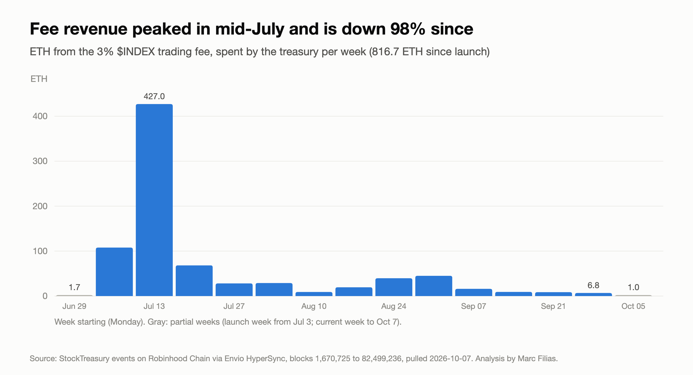
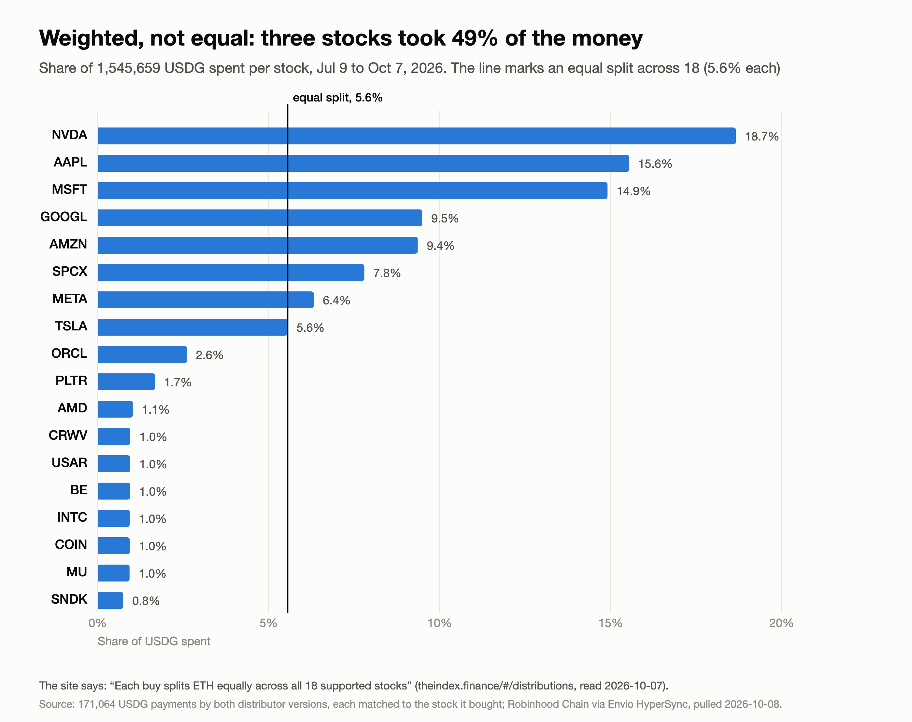
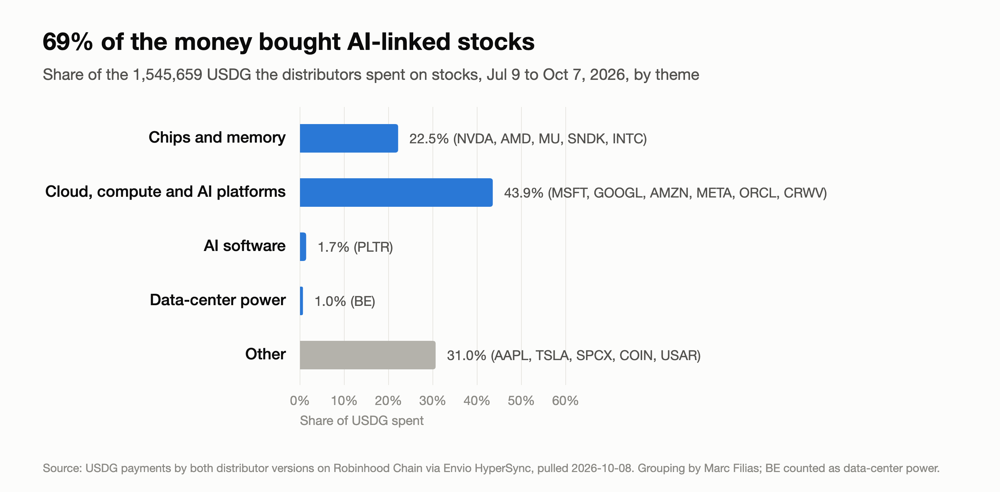
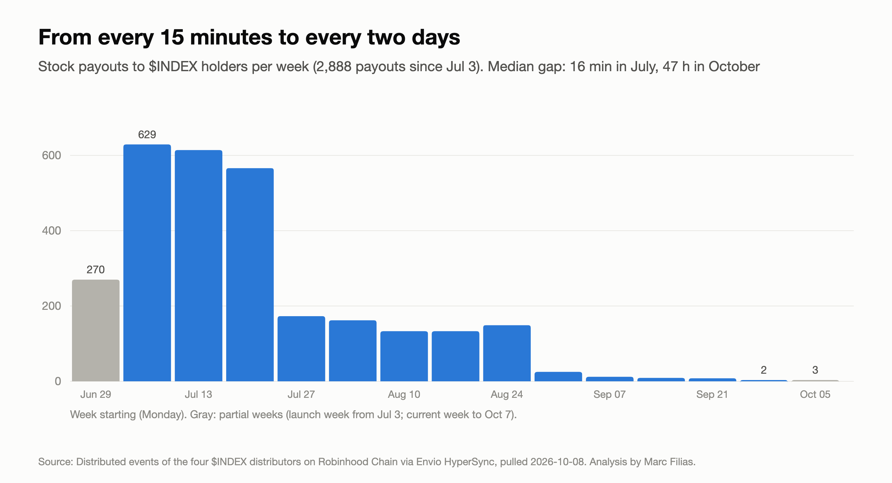
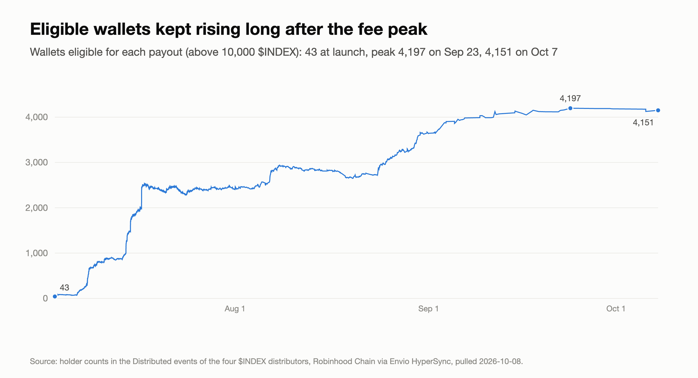

# The Index ($INDEX): onchain analysis

Reproducible data and code for an independent analysis of [The Index](https://theindex.finance), a token on Robinhood Chain whose trading fees buy tokenized stocks for its holders.

Every figure comes from Robinhood Chain event logs: the fees the treasury spent, what the distributor contracts paid for each of the 18 stocks, and each payout to holders, from launch on July 3 to October 8, 2026.

Article: *Trading Fees Have Bought $1.5 Million of Tokenized Stocks, Mostly AI. I Read the Chain to See What Holders Actually Got.* (Medium, October 2026)

> Independent research. Not financial advice. The author holds no $INDEX and has no relationship with the team.

## Findings

| | |
|---|---|
| Fees spent by the treasury | **816.67 ETH** since launch (the site showed 816.57 ETH on Oct 7) |
| Stocks bought | **1.55M USDG** across 171,064 purchases, all matched onchain |
| Weekly fees | **427 ETH** at the peak (week of Jul 13), **6.8 ETH** in the week of Sep 28: down 98% |
| Share of spend on AI-linked stocks | **69%** |
| Weighting | fixed, not equal: NVDA 18.7%, AAPL 15.6%, MSFT 14.9% (top three: 49%) |
| Payouts | **2,888**; median gap 16 minutes in July, 47 hours in October |
| Eligible wallets (above 10,000 $INDEX) | 43 at the first payout, 4,197 at the peak (Sep 23), 4,151 on Oct 7 |

## Charts

### Fee revenue


### Weights per stock


### Spend by theme


### Payout frequency


### Eligible wallets


## Quick start

Rebuild the charts from the included data. Python 3.10+, standard library only, no network:

```bash
git clone https://github.com/yodablocks/the-index-onchain.git
cd the-index-onchain
python3 make_charts.py      # writes html/*.html, one 1400 px SVG per chart
```

## Pull the data yourself

The fetch script uses [Envio HyperSync](https://docs.envio.dev) (free API token) and the public Robinhood Chain RPC for token decimals.

```bash
export ENVIO_API_TOKEN=...
python3 fetch_index_hypersync.py --out data                       # fee hook and treasury events
python3 fetch_index_hypersync.py --out data --part buys           # USDG payments and stocks bought
python3 fetch_index_hypersync.py --out data --part distributions  # payouts of the four distributors
```

- Stays under the free plan's 15 requests per minute (one request every 4.5 s). All three parts take a few minutes.
- Saves a checkpoint after each request (`data/hypersync_<part>.json`) and resumes from it. Delete it to start over.
- Writes plain `.csv`; `make_charts.py` reads `.csv` or `.csv.gz`. A new pull includes later blocks, so numbers will move.

## Repository

```
├── fetch_index_hypersync.py   pulls event logs into data/
├── make_charts.py             builds the five charts into html/
├── charts/                    chart images used in the article
└── data/
    ├── contract_logs.csv.gz       fee hook and StockTreasury events (12,693)
    ├── buys.csv.gz                USDG and stock transfers of the treasury and distributors (354,485)
    ├── distributor_logs.csv.gz    Distributed and per-round events of the four distributors (46,229)
    ├── topics.txt                 event counts per contract
    ├── distributor_topics.txt     event counts per distributor
    └── fetch_log.txt              block range, requests and time of each pull
```

Data pulled October 7 and 8, 2026, from block 1,670,725 (the $INDEX creation transaction, July 3, 2026).

## Contracts

| Contract | Address |
|---|---|
| $INDEX token | `0x56910D4409F3a0C78C64DD8D0545FF0705389870` |
| IndexFeeHook (Uniswap v4) | `0x2cD91bD228ff4c537031d6b8204782090c84c0cC` |
| StockTreasury | `0x1604Ff11dFeAaC437077aEDA2FA492ac9EC804dF` |
| Distributor, Jul 9 to 28 | `0x2459DedB3012d1E929EdD17DF26620120bDF11bf` |
| Distributor, from Jul 28 | `0x39ADB8acD07427D338b5f1AfAb436A04AbFdB7c4` |
| Earlier distributors, Jul 3 to 9 | `0x33B0095333e64bf375952eF197b6FDC3437dc014`, `0x02241379056fd5c2BDe0bDfc63D2b272C18A49bE` |

The four distributor addresses are those listed in The Index's DefiLlama adapter ([DefiLlama/dimension-adapters#8666](https://github.com/DefiLlama/dimension-adapters/pull/8666)).

## Method

- **Fees.** The treasury emits one event per spend (topic `0xe0ad67c3…`); the first data word is the ETH spent.
- **Spend per stock.** Within each transaction, each USDG payment by a distributor is paired with the next stock delivery, in log order: 171,064 pairs, none unmatched. The fixed weights are the same in both USDG-era distributors.
- **Payouts and holders.** The first `Distributed(stock, amount, holders)` event in a transaction counts as one payout; its third field is the number of wallets paid. Wallets, not people.
- **Themes.** The grouping of stocks into themes is the author's. BE (Bloom Energy) counts as data-center power.
- **Filtering.** `distributor_logs.csv.gz` was filtered from a pull of every distributor event (80,968 logs, see `fetch_log.txt`) to the two event types the current script requests. The charts are identical either way.

## Limitations

- USD values are in USDG at the time of purchase, not market value today.
- Fee revenue other than the 3% $INDEX trading fee (about 60,000 USDG from other sources since August) is included in spend per stock, not in the weekly fees chart.
- Onchain data shows what the contracts did, not why. Contract roles are taken from The Index's own documentation and DefiLlama listing.

## License

[MIT](LICENSE). The underlying data is public blockchain data.
